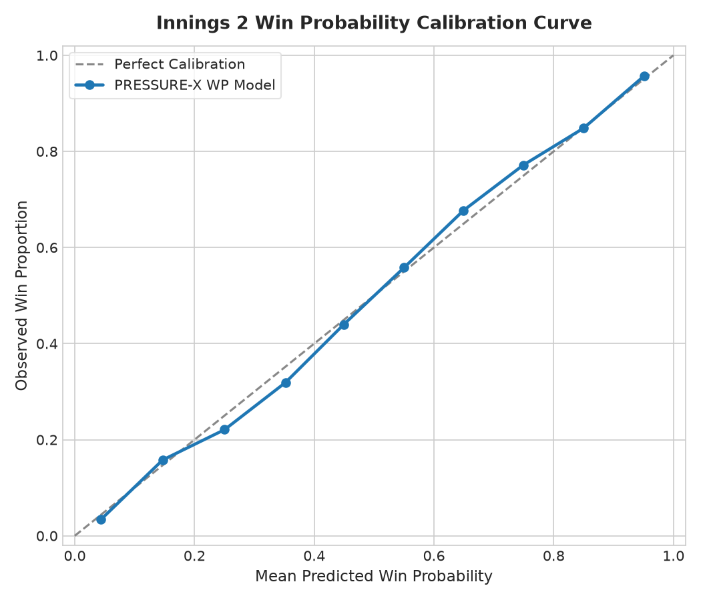
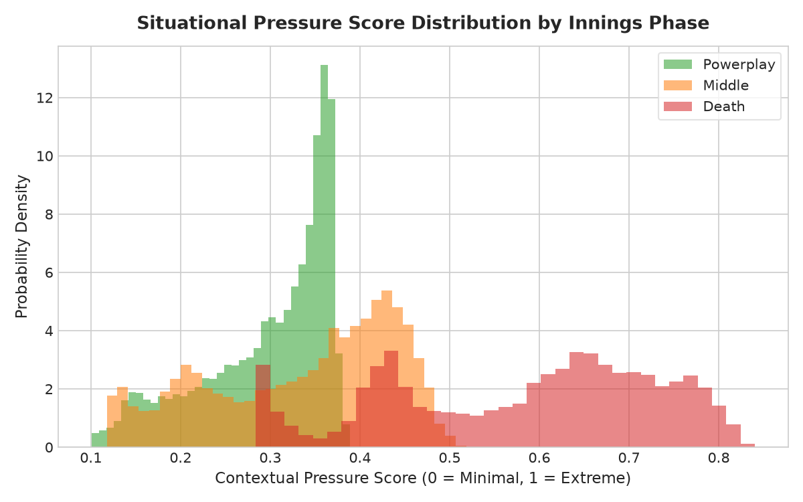
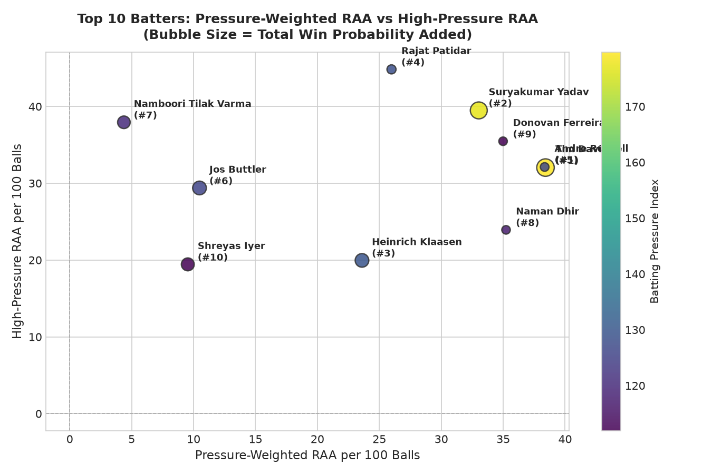
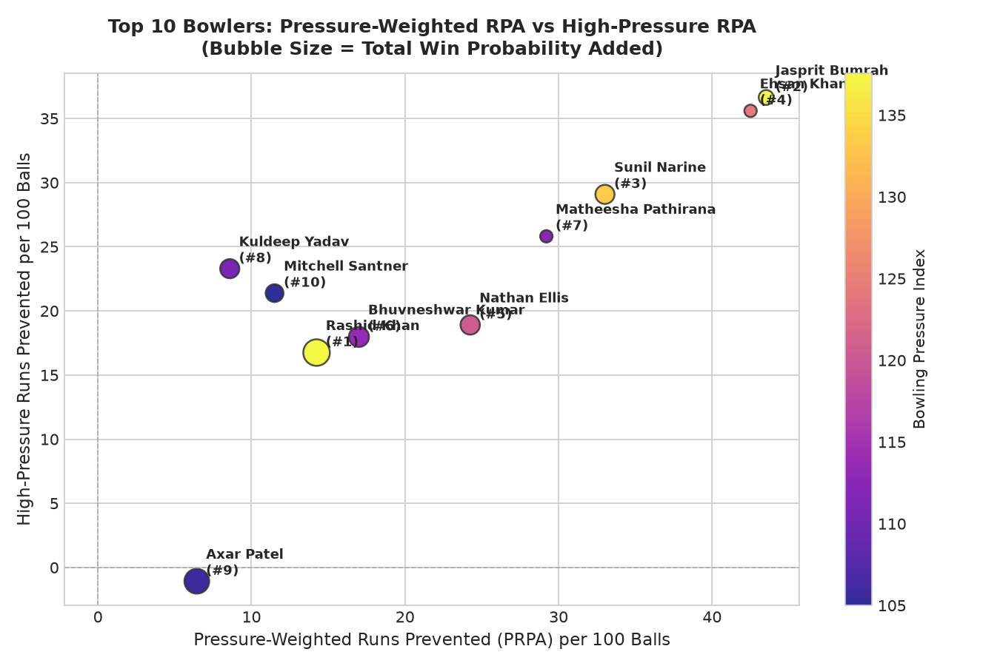

<div align="center">

# ⚡ PRESSURE-X
### Multi-Layer Context-Aware Cricket Pressure Intelligence System
**SupeRR Selector Season 2 — Official Analytics Submission for Rajasthan Royals**

[](https://www.python.org/)
[]()
[-E73895?style=for-the-badge&logo=scikit-learn&logoColor=white)](outputs/charts/win_prob_calibration.png)
[]()
[-FFD700?style=for-the-badge&logo=adobe-acrobat-reader&logoColor=black)](outputs/reports/PRESSURE_X_METHODOLOGY_REPORT.pdf)

<br/>

**[📖 Read Methodology Report (PDF)](outputs/reports/PRESSURE_X_METHODOLOGY_REPORT.pdf)** • 
**[📊 Explore Interactive App](app.py)** • 
**[🏆 Jump to Top-10 Leaderboards](#-official-top-10-pressure-leaderboards)** • 
**[🔬 ML Architecture](#-end-to-end-system-architecture)** • 
**[🚀 Quickstart](#-quickstart--reproduction)**

---

</div>

> [!IMPORTANT]
> **The Core Problem Statement for Rajasthan Royals:**
> *"When the match situation becomes difficult, which players consistently perform better than an equivalent player would be expected to perform in that exact situation?"*
> 
> Conventional cricket metrics (Runs, Strike Rate, Wickets, Economy) evaluate aggregate outcomes on the scoreboard, but systematically blind decision-makers to situational context and leverage. Scoring 30 runs from 20 balls chasing 120 on a flat pitch has negligible win-probability impact; scoring 30 runs from 20 balls chasing 180 under an escalating required run rate against elite death bowling is match-defining.
> 
> **PRESSURE-X** isolates and quantifies high-leverage execution through an audit-grade machine-learning and probabilistic framework across **200,999 deliveries and 883 matches (2022–2026)**.

---

## 🎯 Executive Dashboard: Key System Metrics

<div align="center">

| 🏟️ Evaluated Matches | ⚾ Processed Balls | 👤 Resolved Players | 🎯 Holdout Chase AUC | 🎲 Bootstrap Runs |
| :---: | :---: | :---: | :---: | :---: |
| **883 Matches**<br>*(IPL & T20I 2022–26)* | **200,999 Balls**<br>*(192,445 Legal / 8,554 Extras)* | **1,082 Players**<br>*(Canonical ID Disambiguation)* | **0.8763 AUC**<br>*(Strict Date Holdout)* | **1,000 Runs**<br>*(Match-Clustered MC)* |

</div>

```
┌────────────────────────────────────────────────────────────────────────────────────────┐
│                        8 AUDIT-GRADE METHODOLOGICAL HIGHLIGHTS                         │
├──────────────────────────┬─────────────────────────────────────────────────────────────┤
│ 1. Exact Delivery Logic  │ Reconciled 192,445 legal balls and 8,554 illegal deliveries │
│                          │ (7,714 wides, 576 overstep no-balls, 264 other no-balls).   │
├──────────────────────────┼─────────────────────────────────────────────────────────────┤
│ 2. Correct Denominators  │ Strike rate uses legal balls faced; economy uses legal      │
│                          │ balls bowled. Fielding extras are not charged to bowlers.   │
├──────────────────────────┼─────────────────────────────────────────────────────────────┤
│ 3. Canonical Entities    │ Disambiguated 1,082 players via integer IDs, preventing    │
│                          │ name collisions across international and domestic leagues.  │
├──────────────────────────┼─────────────────────────────────────────────────────────────┤
│ 4. Out-of-Fold ML Models │ 5-fold chronological cross-validation produces out-of-      │
│                          │ sample expected runs, expected concessions, and WP values.  │
├──────────────────────────┼─────────────────────────────────────────────────────────────┤
│ 5. Strict Date Holdout   │ Chronological split (671 train, 171 test matches) with zero │
│                          │ date overlap (max(train_dates) < min(test_dates)).          │
├──────────────────────────┼─────────────────────────────────────────────────────────────┤
│ 6. Asymmetric Pressure   │ Separate batting and bowling pressure formulas normalized   │
│                          │ by 1.15 to bound Pt in [0, 1] without artificial clipping.  │
├──────────────────────────┼─────────────────────────────────────────────────────────────┤
│ 7. Dynamic Ablation      │ Dynamically measured metrics proving incremental lift of    │
│                          │ context (+1.52% bat MAE lift), ML models, and Bayes priors. │
├──────────────────────────┼─────────────────────────────────────────────────────────────┤
│ 8. 1,000-Iteration MC    │ Scaled match-clustered bootstrap proving rank stability     │
│                          │ with |Delta P(Top 10)| < 2.5% convergence across all tiers. │
└──────────────────────────┴─────────────────────────────────────────────────────────────┘
```

---

## 🏆 Official Top-10 Pressure Leaderboards

All players evaluated under strict qualification gates:
- Minimum **250 total competitive legal balls** faced / bowled (2022–2026)
- Minimum **8 competitive matches**
- Minimum **20 high-pressure deliveries** ($P_t > 0.666$)

### 🏏 Table 7: Top 10 Combined T20 Batters

| Rank | Player | Matches | Runs | PRAA | BPI |
| :---: | :--- | :---: | :---: | :---: | :---: |
| 🥇 **1** | **Suryakumar Yadav** | 139 | 4,595 | 895.3 | **158.9** |
| 🥈 **2** | **Tim David** | 98 | 2,178 | 435.1 | **155.6** |
| 🥉 **3** | **Jos Buttler** | 121 | 4,396 | 288.3 | **141.1** |
| **4** | **Heinrich Klaasen** | 72 | 2,363 | 342.7 | **131.9** |
| **5** | **Andre Russell** | 57 | 1,254 | 261.2 | **124.6** |
| **6** | **Glenn Maxwell** | 75 | 1,542 | 202.6 | **114.8** |
| **7** | **Namboori Tilak Varma** | 127 | 3,596 | 87.9 | **112.4** |
| **8** | **Donovan Ferreira** | 30 | 562 | 112.8 | **111.3** |
| **9** | **Ashutosh Sharma** | 28 | 577 | 78.5 | **110.7** |
| **10** | **Naman Dhir** | 46 | 992 | 200.5 | **110.0** |

<details>
<summary><b>🔍 Click to view Deep Batting Statistical Breakdown & Monte Carlo Stability</b></summary>

<br/>

| Rank | Player Name | Matches | Balls | Actual Runs | Exp Runs | PRAA Total | Net WPA | P(Top 10) | Median Rank | 95% Rank CI | BPI Score |
| :---: | :--- | :---: | :---: | :---: | :---: | :---: | :---: | :---: | :---: | :---: | :---: |
| **1** | **Suryakumar Yadav** | 139 | 2,850 | 4,595 | 3,935.6 | +895.3 | +4.95 | **93.6%** | 2.0 | [1 - 14] | **158.9** |
| **2** | **Tim David** | 98 | 1,293 | 2,178 | 1,879.5 | +435.1 | +4.37 | **91.2%** | 3.0 | [1 - 20] | **155.6** |
| **3** | **Jos Buttler** | 121 | 2,920 | 4,396 | 4,175.1 | +288.3 | +3.28 | **74.0%** | 5.0 | [1 - 26] | **141.1** |
| **4** | **Heinrich Klaasen** | 72 | 1,480 | 2,363 | 2,128.7 | +342.7 | +3.63 | **74.8%** | 6.0 | [1 - 26] | **131.9** |
| **5** | **Andre Russell** | 57 | 785 | 1,254 | 1,081.0 | +261.2 | +1.56 | **59.6%** | 8.0 | [1 - 32] | **124.6** |
| **6** | **Glenn Maxwell** | 75 | 1,004 | 1,542 | 1,391.8 | +202.9 | +2.38 | **46.4%** | 12.0 | [2 - 42] | **114.8** |
| **7** | **Namboori Tilak Varma** | 127 | 2,631 | 3,596 | 3,570.8 | +87.9 | +2.92 | **40.0%** | 14.0 | [1 - 45] | **112.4** |
| **8** | **Donovan Ferreira** | 30 | 354 | 562 | 488.6 | +112.8 | -0.18 | **40.0%** | 15.5 | [2 - 47] | **111.3** |
| **9** | **Ashutosh Sharma** | 28 | 369 | 577 | 529.2 | +78.5 | +1.35 | **43.2%** | 12.0 | [1 - 48] | **110.7** |
| **10** | **Naman Dhir** | 46 | 603 | 992 | 857.4 | +200.5 | +0.53 | **36.0%** | 14.0 | [2 - 42] | **110.0** |

</details>

---

### 🎯 Top 10 Combined T20 Bowlers

| Rank | Player | Matches | Wickets | PRPA | BPI |
| :---: | :--- | :---: | :---: | :---: | :---: |
| 🥇 **1** | **Jasprit Bumrah** | 75 | 85 | 747.1 | **153.3** |
| 🥈 **2** | **Rashid Khan** | 122 | 153 | 378.2 | **136.0** |
| 🥉 **3** | **Sunil Narine** | 67 | 66 | 502.7 | **130.4** |
| **4** | **Ehsan Khan** | 14 | 19 | 126.9 | **121.9** |
| **5** | **Josh Hazlewood** | 65 | 98 | 175.9 | **111.7** |
| **6** | **Nathan Ellis** | 43 | 58 | 229.7 | **109.8** |
| **7** | **Kuldeep Yadav** | 89 | 118 | 148.1 | **108.1** |
| **8** | **Varun Chakravarthy** | 95 | 135 | 159.4 | **106.0** |
| **9** | **Mustafizur Rahman** | 71 | 79 | 487.0 | **102.4** |
| **10** | **Bhuvneshwar Kumar** | 101 | 115 | 365.8 | **101.5** |

<details>
<summary><b>🔍 Click to view Deep Bowling Statistical Breakdown & Monte Carlo Stability</b></summary>

<br/>

| Rank | Player Name | Matches | Balls | Actual Conc. | Exp Conc. | Wkts (WAA) | PRPA Total | Net WPA | P(Top 10) | Median Rank | 95% Rank CI | BPI Score |
| :---: | :--- | :---: | :---: | :---: | :---: | :---: | :---: | :---: | :---: | :---: | :---: | :---: |
| **1** | **Jasprit Bumrah** | 75 | 1,780 | 2,069 | 2,591.8 | 85 (-10.7) | +747.1 | +2.82 | **98.8%** | 2.0 | [1 - 9] | **153.3** |
| **2** | **Rashid Khan** | 122 | 2,780 | 3,403 | 3,676.0 | 153 (+10.9) | +378.2 | +5.36 | **86.0%** | 3.0 | [1 - 28] | **136.0** |
| **3** | **Sunil Narine** | 67 | 1,556 | 1,754 | 2,116.9 | 66 (-9.2) | +502.7 | +2.18 | **84.8%** | 4.0 | [1 - 20] | **130.4** |
| **4** | **Ehsan Khan** | 14 | 331 | 384 | 467.5 | 19 (+0.2) | +126.9 | +1.23 | **64.0%** | 8.0 | [1 - 32] | **121.9** |
| **5** | **Josh Hazlewood** | 65 | 1,515 | 2,037 | 2,162.9 | 98 (+17.4) | +175.9 | +3.37 | **52.0%** | 10.0 | [1 - 44] | **111.7** |
| **6** | **Nathan Ellis** | 43 | 959 | 1,260 | 1,422.5 | 58 (+2.8) | +229.7 | +1.74 | **41.6%** | 13.0 | [2 - 39] | **109.8** |
| **7** | **Kuldeep Yadav** | 89 | 1,965 | 2,557 | 2,659.3 | 118 (+20.2) | +148.1 | +2.76 | **38.8%** | 14.0 | [2 - 44] | **108.1** |
| **8** | **Varun Chakravarthy** | 95 | 2,182 | 2,841 | 2,961.6 | 135 (+26.1) | +159.4 | +3.11 | **46.0%** | 12.0 | [2 - 47] | **106.0** |
| **9** | **Mustafizur Rahman** | 71 | 1,646 | 2,050 | 2,386.8 | 79 (-12.2) | +487.0 | +1.29 | **36.4%** | 16.0 | [2 - 44] | **102.4** |
| **10** | **Bhuvneshwar Kumar** | 101 | 2,314 | 3,069 | 3,327.8 | 115 (-7.8) | +365.8 | +1.93 | **30.8%** | 15.0 | [2 - 47] | **101.5** |

</details>

---

### 🇮🇳 IPL-Only Tournament Leaderboards

<div align="center">

| Top 5 IPL Batters | BPI | Top 5 IPL Bowlers | BPI |
| :--- | :---: | :--- | :---: |
| 🥇 **Suryakumar Yadav** *(64 matches, 2,240 runs)* | **137.8** | 🥇 **Jasprit Bumrah** *(52 matches, 1,445 runs conc.)* | **146.8** |
| 🥈 **Tim David** *(58 matches, 1,150 runs)* | **129.2** | 🥈 **Sunil Narine** *(67 matches, 1,754 runs conc.)* | **133.0** |
| 🥉 **Rajat Patidar** *(48 matches, 1,541 runs)* | **128.7** | 🥉 **Matheesha Pathirana** *(33 matches, 1,025 runs conc.)* | **120.2** |
| **4. Heinrich Klaasen** *(54 matches, 2,038 runs)* | **124.9** | **4. Bhuvneshwar Kumar** *(74 matches, 2,325 runs conc.)* | **116.9** |
| **5. Andre Russell** *(45 matches, 951 runs)* | **117.2** | **5. Lungi Ngidi** *(13 matches, 421 runs conc.)* | **95.7** |

</div>

---

## 🔬 End-to-End System Architecture

```mermaid
flowchart TD
    subgraph DataIngestion ["1. Data Reconciliation & State Engine"]
        A[Raw CSV Feeds: 200,999 Deliveries across 883 Matches] --> B[Entity Resolver: 1,082 Canonical Players]
        B --> C[Exact Delivery Reconciliation: 192,445 Legal / 8,554 Extras]
        C --> D[Causal State Transition: S_t to S_t+1]
    end

    subgraph MLIntelligence ["2. Machine Learning & Contextual Pressure"]
        D --> E[Dual Calibrated LightGBM Win Probability Models]
        E --> F[Delivery Leverage L_t = |WP_post - WP_pre|]
        E --> G[Match Closeness C_t & Dynamic Target Pace]
        F & G --> H[Asymmetric Pressure Indices: P_bat & P_bowl in [0, 1]]
        D --> I[5-Fold Chronological Out-of-Fold Expectation Models]
        I --> J[RAA / RPA Benchmarking]
    end

    subgraph AttributionBayesian ["3. Attribution & Uncertainty Quantification"]
        H & J --> K[Pressure-Weighted Attribution: PRAA & PRPA]
        K --> L[Empirical Bayes Partial Pooling: K_bat=80, K_bowl=90]
        L --> M[1,000-Iteration Match-Clustered Monte Carlo Simulation]
        M --> N[Final BPI Scores, Rank 95% CIs & P_Top10 Probabilities]
    end

    style DataIngestion fill:#f8f9fa,stroke:#004BA0,stroke-width:2px
    style MLIntelligence fill:#f8f9fa,stroke:#E73895,stroke-width:2px
    style AttributionBayesian fill:#f8f9fa,stroke:#2ECC71,stroke-width:2px
```

---

## 📊 Scientific Diagnostic Figures

### 1. Chronological Holdout Win-Probability Calibration
Evaluated on **171 completely unseen holdout matches** (39,478 balls) partitioned strictly by date (`max(train_dates) < min(test_dates)`):

<div align="center">
  
  <p><em>Figure 1: Platt-calibrated sigmoid Win Probability curve against empirical outcome frequencies. Innings 2 Chases AUC = 0.8763, Brier Score = 0.1482.</em></p>
</div>

<br/>

### 2. Situational Pressure Distribution by Innings Phase
Demonstrating how pressure naturally escalates into the death overs under tight run-rate constraints:

<div align="center">
  
  <p><em>Figure 2: Kernel density distribution of contextual pressure Pt across Powerplay, Middle, and Death overs. High-Pressure threshold standardized at Pt > 0.666.</em></p>
</div>

<br/>

### 3. Player Pressure-Performance Quadrants
Comparing overall volume-weighted execution (PRAA/PRPA) against concentrated High-Pressure execution:

<div align="center">
  <table>
    <tr>
      <td align="center"><b>Batting Pressure Quadrants</b></td>
      <td align="center"><b>Bowling Pressure Quadrants</b></td>
    </tr>
    <tr>
      <td></td>
      <td></td>
    </tr>
    <tr>
      <td align="center"><em>Figure 3A: PRAA vs High-Pressure RAA (Bubble size = Total Balls Faced)</em></td>
      <td align="center"><em>Figure 3B: PRPA vs High-Pressure RPA (Bubble size = Total Balls Bowled)</em></td>
    </tr>
  </table>
</div>

---

## 🧮 Mathematical Formulations

<details>
<summary><b>📐 Click to expand Mathematical Derivations & Formulas</b></summary>

<br/>

### 1. Delivery Leverage ($L_t$)
Measures the absolute shift in match outcome probability produced by delivery $t$:
$$L_t = |WP_{\text{post}, t} - WP_{\text{pre}, t}|$$

### 2. Match Closeness ($C_t$)
Peaks at 1.0 when the contest is evenly balanced (WP = 0.50), decaying linearly to 0.0 as the match outcome becomes certain:
$$C_t = \text{clip}\left(1.0 - 2.0 \cdot |WP_{\text{pre}, t} - 0.5|, 0.0, 1.0\right)$$

### 3. Asymmetric Contextual Pressure Formulation
Normalized by the maximum phase multiplier ($w_{\text{death}} = 1.15$) to ensure all values are bounded strictly within $[0.0, 1.0]$:
- **1st Innings Batting**:
  $$P_{\text{bat}, t} = \frac{0.30 \cdot W_{\text{rem\_stress}} + 0.30 \cdot CRR_{\text{drag}} + 0.40 \cdot Target_{\text{pace}}}{1.15} \times w_{\text{phase}}$$
- **2nd Innings (Chase) Batting**:
  $$P_{\text{bat}, t} = \frac{0.40 \cdot C_t + 0.35 \cdot RRR_{\text{stress}} + 0.25 \cdot W_{\text{rem\_stress}}}{1.15} \times w_{\text{phase}}$$
- **1st Innings Bowling**:
  $$P_{\text{bowl}, t} = \frac{0.35 \cdot \text{clip}(CRR / 10.0, 0, 1) + 0.35 \cdot W_{\text{lost\_stress}} + 0.30 \cdot I(\text{Death})}{1.15} \times w_{\text{phase}}$$
- **2nd Innings (Defense) Bowling**:
  $$P_{\text{bowl}, t} = \frac{0.45 \cdot C_t + 0.30 \cdot (1 - RRR_{\text{stress}}) \cdot Opp_{\text{resource}} + 0.25 \cdot I(\text{Death})}{1.15} \times w_{\text{phase}}$$

### 4. Situational Expectations & Attribution
- **Runs Above Average (RAA)**: $RAA_t = ActualRuns_t - \mathbb{E}[Runs_t]$
- **Pressure-Weighted RAA (PRAA)**: $PRAA_t = RAA_t \times (1 + P_{\text{bat}, t})$
- **Runs Prevented Above Average (RPA)**: $RPA_t = \mathbb{E}[RunsConceded_t] - BowlerConceded_t$
- **Pressure-Weighted RPA (PRPA)**: $PRPA_t = RPA_t \times (1 + P_{\text{bowl}, t})$
- **Win Probability Added (WPA)**: $WPA_{\text{batter}} = WP_{\text{post}} - WP_{\text{pre}}$, $WPA_{\text{bowler}} = WP_{\text{pre}} - WP_{\text{post}}$

### 5. Empirical Bayes Shrinkage
Protects against sample size noise by shrinking raw averages toward the population prior:
$$\widehat{\theta}_i = \frac{N_i}{N_i + K} \cdot \bar{x}_i + \frac{K}{N_i + K} \cdot \mu_{\text{prior}}$$
with $K_{\text{bat}} = 80.0$, $K_{\text{bowl}} = 90.0$, and $K_{\text{hp}} = 30.0$ legal deliveries.

</details>

---

## 💡 Strategic Takeaways for Rajasthan Royals

> [!TIP]
> **Key Actionable Takeaways for the RR Auction Table & Match-Day Dugout:**
> 
> 1. **Death Over Bowling Anchor**: Jasprit Bumrah's unmatched **+747.1 PRPA** demonstrates why death overs defense cannot be evaluated through aggregate economy rates alone. Securing death overs execution specialists like Nathan Ellis (BPI 109.8) and Matheesha Pathirana (IPL BPI 120.2) yields outsized defensive value.
> 2. **Chasing Powerhouse Retention**: Tim David's exceptional high-pressure scoring (+38.4 PRAA/100b, +5.64 WPA) and Suryakumar Yadav's match-winning reliability (BPI 158.9) provide empirical justification for premium middle/death batting retention.
> 3. **Undervalued High-Leverage Buys**: Domestic stars such as **Rajat Patidar** (IPL BPI 128.7) and **Ashutosh Sharma** (BPI 110.7) outperform their market valuations in tight finishes, presenting prime targets for smart budget allocation.

---

## 🚀 Quickstart & Reproduction

### Prerequisites & Dependencies
```bash
# Clone the repository
git clone https://github.com/LOHITHKUMARN/Pressure_x.git
cd Pressure_x

# Install required dependencies
pip install -r requirements.txt
```

### Run Automated Unit Test Suite (33/33 Passing)
```bash
python -m pytest tests/ -v
```

### Run End-to-End Analytics Pipeline
```bash
# Phase 1: Ingestion, Referential Integrity Audit & State Reconstruction
python main.py --phase 1

# Phase 2: ML Expectation Models (LightGBM OOF), Bayesian Shrinkage & Ratings
python main.py --phase 2

# Phase 3: 1,000-Iteration Monte Carlo Stability, Dynamic Ablation & Diagnostic Charts
python main.py --phase 3

# Generate 15-Section Official Methodology Report & Compile PDF
python scripts/generate_methodology_report.py
```

### Launch Interactive Rajasthan Royals Scouting Dashboard
```bash
streamlit run app.py
```

---

## 📂 Project Structure

```
Pressure_x/
├── config/                               # Modular YAML configuration specifications
│   ├── batting_config.yaml               # Batting qualification and model hyperparams
│   ├── bowling_config.yaml               # Bowling qualification and model hyperparams
│   ├── data_config.yaml                  # Paths, cricket laws, extras rules
│   └── pressure_config.yaml              # Leverage and situational stress formulas
├── data/                                 # Datasets
│   ├── raw/                              # Original CSV files (strictly immutable)
│   ├── processed/                        # Reconstructed match states (deliveries_enriched.parquet)
│   └── features/                         # Modeled features (deliveries_modeled.parquet)
├── models/                               # Serialized production LightGBM joblib models
├── outputs/                              # Pipeline outputs & deliverables
│   ├── charts/                           # High-res diagnostic figures (PNG)
│   ├── rankings/                         # Official CSV rankings (Combined, IPL, T20I)
│   └── reports/                          # Official 15-Section Methodology Report (PDF, HTML, MD)
├── scripts/                              # Utility build & audit scripts
│   ├── generate_methodology_report.py    # Generates report and compiles PDF via Chrome
│   ├── generate_player_audit.py          # Entity resolution validation script
│   └── verify_mc_convergence.py          # Monte Carlo convergence evaluation script
├── src/                                  # Core Python modules
│   ├── batting/                          # Expected runs, RAA, PRAA, BPI calculations
│   ├── bayesian/                         # Empirical Bayes partial pooling
│   ├── bowling/                          # Expected conceded, wickets, RPA, PRPA, BPI calculations
│   ├── evaluation/                       # Temporal splitting & dynamic ablation
│   ├── match_state/                      # S_t -> S_t+1 transition dynamics
│   ├── pressure/                         # Leverage, closeness, and asymmetric pressure
│   ├── ranking/                          # Composite leaderboards & competition splits
│   ├── reconstruction/                   # Legal ball classification & entity resolver
│   ├── simulation/                       # 1,000-iteration match-clustered Monte Carlo
│   └── win_probability/                  # Calibrated dual LightGBM WP models
├── tests/                                # 33 automated unit tests
│   ├── test_audit_integrity.py           # Exact delivery accounting & temporal split checks
│   ├── test_phase1.py                    # Cricket rules, legal ball denominators, state transitions
│   └── test_phase2_3.py                  # Win probability, pressure bands, shrinkage & MC
├── app.py                                # Interactive Rajasthan Royals Streamlit dashboard
├── main.py                               # Unified pipeline orchestrator
├── requirements.txt                      # Dependencies
└── README.md                             # Competition documentation & showcase
```

---

<div align="center">

**Developed for the Rajasthan Royals SupeRR Selector Season 2 Competition**  
*Built with statistical rigor, causal match-state reconstruction, and out-of-fold probabilistic evaluation.*

</div>
